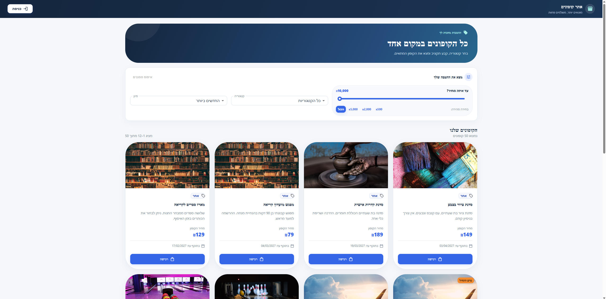
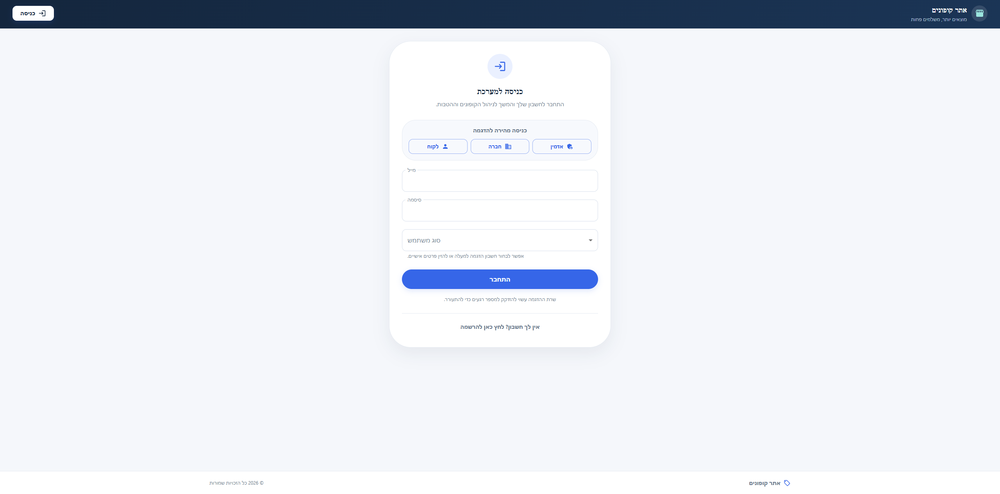
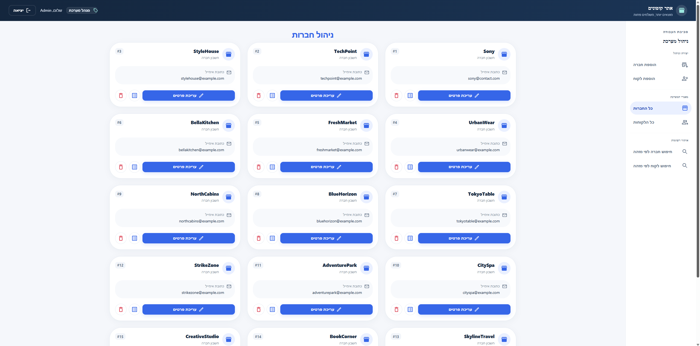
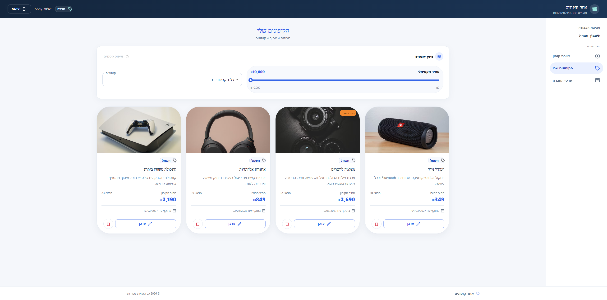
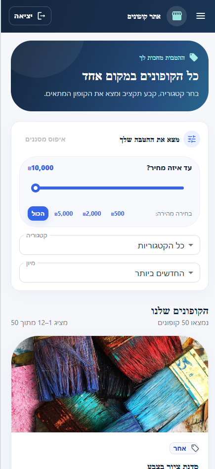
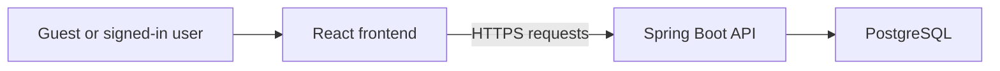

# Coupon Management System — Frontend

A responsive Hebrew coupon marketplace built with React and TypeScript.
Visitors can browse offers, while customers, companies, and administrators
can use dedicated account flows.

[](https://github.com/elad9219/coupons-system-react/actions/workflows/frontend-ci.yml)

| | Link |
| --- | --- |
| Live demo | [Open the application](https://coupons-gamma.vercel.app/) |
| Backend repository | [Coupon System Backend](https://github.com/elad9219/coupons-system-backend) |
| API documentation | [Swagger UI](https://coupons.runmydocker-app.com/swagger-ui.html) |

> The backend runs on a free hosting service and may need time to wake up
> after inactivity. The application displays a loading message and retries
> safe read requests while the server starts.

## Screenshots

### Coupon catalog



### Demo sign-in



### Administrator: company management



### Company: coupon management



### Mobile view



## Features

| Area | Capabilities |
| --- | --- |
| Guest | Browse the catalog, filter by category and price, sort, and register |
| Customer | Purchase available coupons, view purchases, and update account details |
| Company | Create, update, delete, and manage company coupons |
| Administrator | Manage companies and customers |
| User experience | Hebrew right-to-left layout, responsive screens, loading states, validation, and error messages |

The public catalog requests one page at a time from the backend.
Filtering and sorting are also handled by the backend.

## Demo accounts

Choose a role using the quick sign-in buttons on the login screen.

| Role | Email | Password |
| --- | --- | --- |
| Administrator | `admin@admin.com` | `admin` |
| Company | `sony@contact.com` | `1234` |
| Customer | `kobi@gmail.com` | `1234` |

These credentials are for the public demo only. Demo data is recreated
when the demo backend restarts, so changes and purchases are temporary.

## Technologies

| Technology | Purpose |
| --- | --- |
| React 18 and TypeScript | Application and component development |
| Material UI | Responsive interface components |
| Redux Toolkit and React Redux | Client-side state |
| React Router | Navigation |
| Axios | API communication |
| Jest and React Testing Library | Automated tests |
| GitHub Actions | Tests and production build |
| Vercel | Frontend hosting |

## Local development

### Requirements

- Node.js 22 and npm
- The [backend application](https://github.com/elad9219/coupons-system-backend) running locally
- A PostgreSQL database configured for the backend

The frontend uses the browser's current hostname and port `8080` for the
backend in development. For the default setup, open the frontend at
`http://localhost:3000` and run the backend at `http://localhost:8080`.

### Start the application

```bash
git clone https://github.com/elad9219/coupons-system-react.git
cd coupons-system-react
npm ci
npm start
```

Open [http://localhost:3000](http://localhost:3000).

For backend configuration and startup instructions, see the
[backend README](https://github.com/elad9219/coupons-system-backend).

## Tests and build

```bash
CI=true npm test -- --watch=false --runInBand
npm run build
```

The frontend workflow runs tests and a production build on pushes and pull
requests.

## Architecture



The production frontend is hosted on Vercel and communicates with the
backend hosted on RunMyDocker.

## Related repository

- [Backend API and database logic](https://github.com/elad9219/coupons-system-backend)

## Author

**Elad Tennenboim**

- [GitHub](https://github.com/elad9219)
- [LinkedIn](https://www.linkedin.com/in/elad-tennenboim/)
- [Portfolio](https://eladt-portfolio.vercel.app/)
- [Email](mailto:elad9219@gmail.com)